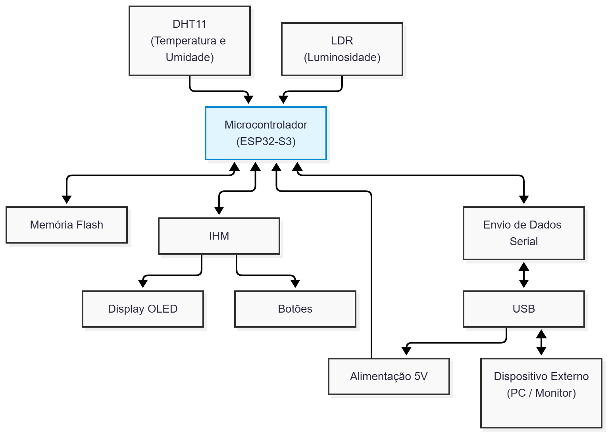

# Projeto de monitoramento e controle de estufa

O objetivo do projeto é desenvolver um sistema de monitoramento e controle de uma estufa, utilizando sensores para medir luminosidade, temperatura e umidade, além de permitir o controle de um ventilador com o objetivo de controlar a temperatura interna da estufa.  

O dispositivo se interage com o usuário através de um display OLED (SSD1306) e o operador pode interagir com o menu no display por meio dos botões conectados ao ESP32. O operador pode monitorar informações em tempo real de temperatura, umidade, luminosidade, estado da ventoinha e o setpoint de temperatura. Além disso, o operador pode alterar o setpoint de temperatura, habilitar/desabilitar o controle de temperatura habilitar/desabilitar o registro de dados na memória.  

Como acabou de ser dito acima, o sistema permite o registro de dados na memória, o qual permite que sejam salvos as últimas configurações realizadas do setpoint de temperatura, estado do registro de dados e estado do controle de temperatura. Além das configurações, o sistema também registra os dados de monitoramento de temperatura, umidade e luminosidade, dizendo em que momento determinado registro aconteceu desde a inicialização do microcontrolador. Esses registros podem ser lidos via porta serial.  

## Instruções de instalação

### Requisitos mínimos

- ESP32-S3 (foi o utilizado na criação desse projeto, mas também podem ser utilizados outros modelos, sendo feitas as devidas alterações);
- Sensor DHT11 ou DHT22;
- Sensor LDR (pode ser feito com divisor de tensão ou módulo pronto com saída analógica);
- Display I2C SSD1306 128x64 pixels;
- Computador com porta USB e terminal serial.  

### Ligação dos componentes

A ligação dos componentes pode ser alterada por meio do arquivo sdkconfig (menuconfig). Para isso, o usuário deve alterar as configurações dos menus:
- GPIOs Configuration;
- Display Configuration;
- Sensors Configuration;
- SSD1306 Configuration.

Caso seja de desejo do usuário apenas compilar o código e rodar, o mesmo pode apenas realizar as conexões dos componentes abaixo (funciona tanto com ESP32-S2 como ESP32-S3 sem a necessidade de alterações):

|     Dispositivo    | Pino | GPIO |            Descrição                |
|--------------------|:----:|:----:|-------------------------------------|
|  Botão para cima   |VCC   |   7  | Botão para navegar para cima no menu|
|  Botão para cima   |GND   | GND  |                                     |
|  Botão para baixo  |VCC   |   4  |Botão para navegar para baixo no menu|
|  Botão para baixo  |GND   | GND  |                                     |
|Botão para esquerda |VCC   |   6  |Botão para retornar no menu          |
|Botão para esquerda |GND   | GND  |                                     |
|Botão para direita  |VCC   |   5  |Botão para avançar no menu/confirmar alterações|
|Botão para direita  |GND   | GND  |                                     |
|Sensor LDR          |SIG   |   1  |Sensor de luminosidade (sinal analógico)|
|DHT11/DHT22         |DATA  | 15   |Sensor de temperatura e umidade      |
|SSD1306             |SCL   |   9  |Display para interação com usuário   |
|SSD1306             |SDA   |   8  |                                     |
### Passo a passo de instalação

1. Instale todos os arquivos desse repositório e adicione eles em uma pasta, de preferência sem caracteres fora do padrão ASCII;
2. Com o VSCode e com o ESP-IDF instalado corretamente (v5.5.5 ou superior), abra a pasta criada no *workspace* do VSCode. A extensão do ESP-IDF deve ser ativada automaticamente;
3. Adicione o *target* para a sua placa (de preferência ESP32-S2 ou S3), selecione a porta COM/dev que sua placa se encontra, e selecione o método de instalação UART;
4. Caso esteja com o ESP32-S3, conecte a USB do computador na porta UART/COM e utilize a opção *Build, flash and monitor* e desfrute do projeto!

Caso seja de interesse utilizar esse projeto em outros devkits, O usuário deve modificar o arquivo sdkconfig para adequar o projeto para seu cenário.

Por padrão, o projeto considera que a flash interna do módulo é de 2 MB. Entretanto, o usuário pode mudar a tabela de partições que está sendo utilizada por meio do sdkconfig (menuconfig), podendo escolher configurações de:

- 2 MB (partitions_2MB.csv);
- 4 MB (partitions_4MB.csv);
- 8 MB (partitions_8MB.csv);
- 16 MB (partitions_16MB.csv).

Antes de tudo, é recomendado que antes de mudar o tamanho da partição, o usuário rode no terminal do ESP-IDF o comando idf.py erase-flash, e então, mude o tamanho da partição e o tamanho total da flash.

## Diagrama de blocos do projeto

### Componentes externas utilizadas

[Componente para DHT11](https://github.com/UncleRus/esp-idf-lib "UncleRus esp-idf-lib")  
[Componente para SSD1306](https://github.com/nopnop2002/esp-idf-ssd1306 "nopnop2002 esp-idf-ssd1306")  
[Componente para LittleFS](https://github.com/joltwallet/esp_littlefs "joltwallet esp_littlefs")